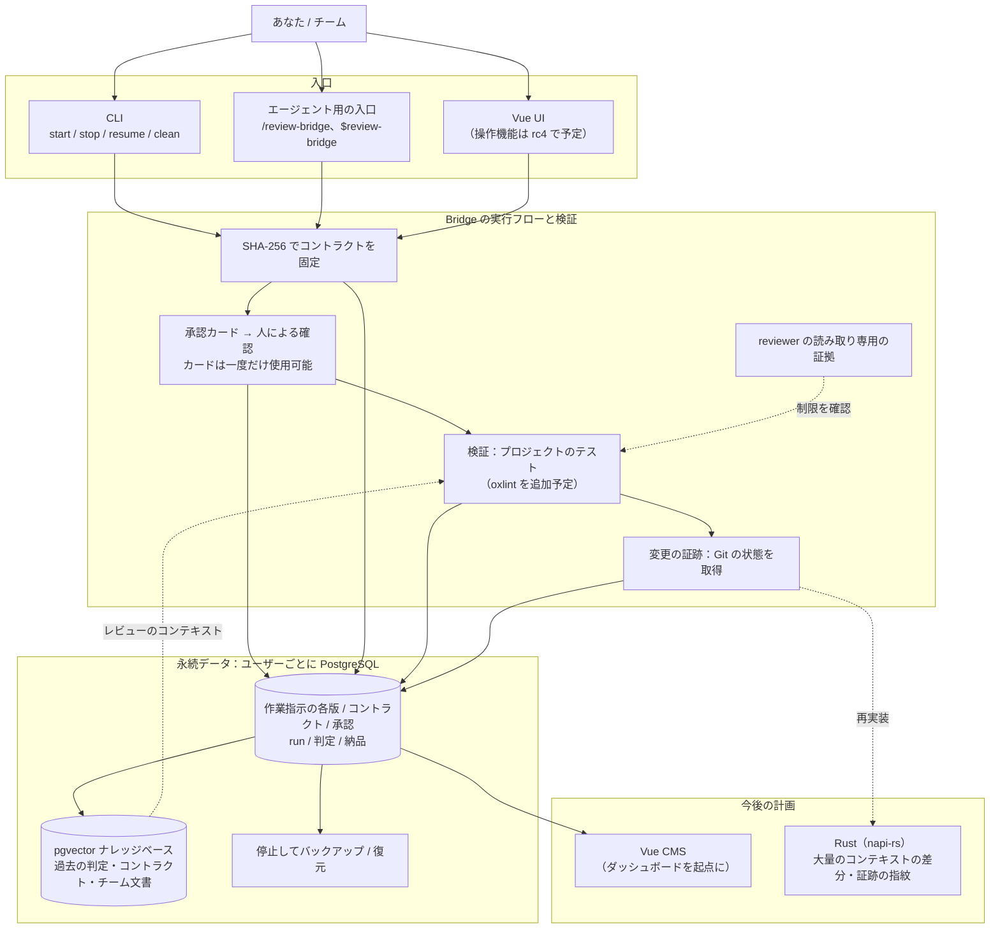

# アーキテクチャとロードマップ

Review Bridge は AI による作業を管理する司令塔です。ユーザーが方針を決め、Bridge が承認、実行、完了条件の確認を管理します。長期的には、承認者、実行の根拠となったコントラクト、実際の変更、レビュー担当を追跡できる、**企業でも使える AI 作業監査システム**を目指しています。

このページでは目標とする構成と開発段階を説明します。0.3.0-rc.3 は実行と監査の基盤を扱います。図に含まれる将来の機能は、まだ計画段階です。

## 目標アーキテクチャ

## 4 つの中核機能

次の制約は Bridge がコードで適用します。skill、プロンプト、モデルの自己申告だけでは保証できません。

1. **コントラクトの固定**：モデルを使わず、マーカー付きブロックを転記して完了条件を分割します。SHA-256 で固定し、カードに表示します。実装とレビューは同じコントラクトを使い、内容が改変されたら停止します。
2. **reviewer の権限制限の確認**：CLI の読み取り専用設定を検証し、証拠を保存します。Codex はサンドボックスによる書き込み拒否、Claude Code はセッションのモードとツール一覧を確認します。証拠の強さは異なります。
3. **変更できない承認記録**：各 run には、ターミナルでの直接承認かエージェントを介したユーザーの承認が必要です。カードは一度だけ使用でき、有効な承認がなければ実行しません。
4. **Git に基づく変更の証跡**：Git の状態とバージョンを取った時点の情報を根拠にし、モデルの申告は別記します。

他の設計も、オープンソースの既存の実践に基づく必要があります。参考にできる前例のない設計は採用しません。[設計の参考資料](./references)を参照してください。

## ロードマップ

| バージョン | 内容 | 状況 |
|---|---|---|
| **0.3.0-rc.3** | `npx review-bridge init` → 作業指示 → `start` → ユーザーの承認 → 実行 → 結果ファイル → **SQL での照会**。VS Code からの接続、エージェント・VS Code・ターミナルの入口、4 通りの役割の組み合わせ、両 provider の権限確認、個人コネクターの分離、モデルを使わないコントラクト作成、フォルダー単位の順次実行、プロジェクトの graph、OS 標準ディレクトリへの記録に対応 | 2026年11月10日に npm で公開。本文書の対象 |
| **今後の作業** | git worktree による並行作業の分離、追加の reviewer MCP サーバーごとの検証 | 計画中。まだ利用できません |
| **rc4** | Vue 3.5 の画面からコントラクト、実行状態、完了条件の判定を確認し、作業や予算を操作。データ保存との統合も行う | 計画中 |
| 将来の方向性 | pgvector で過去の判定、コントラクト、チーム文書を検索し、reviewer に提供 | 対象バージョン未定 |
| その後 | Vue CMS。大きなコンテキストの差分や変更の証跡の指紋を Rust・napi-rs で処理し、npm の JavaScript 入口は維持。検証に oxlint を追加 | 方向性のみ |

rc3 の受け入れにはデータベースの利用も含みます。ユーザーが `init` の接続情報で VS Code から接続し、作業指示の各版、コントラクトのハッシュ、判定、承認経路（`authorized_via`）を検索できる必要があります。

## 未決定の事項

CMS の機能範囲、RAG を reviewer に渡す方法とタイミング、最初の Rust 実装対象、企業向けの提供形態（複数ユーザー、権限、サービス化）は未決定です。CMS の技術構成は Vue 3、TypeScript、Zod、oRPC、Element Plus まで決まっています。具体的な案は決定後に記載します。
