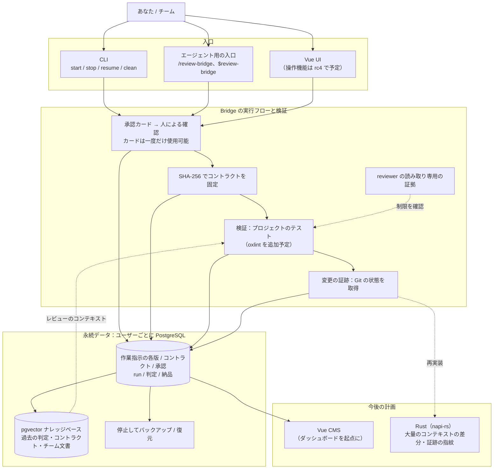

# アーキテクチャとロードマップ

Review Bridge は AI 作業を指揮する艦橋です。人が方向を決め、Bridge が承認、実行、受け入れ判定を管理します。長期的には、**企業でも利用できる AI 作業の監査システム**を目指しています。誰が承認し、どのコントラクトに従い、何が変わり、誰がレビューしたかを追跡できる仕組みです。

このページでは目標の構成と開発段階を説明します。rc3 は実行と監査の基盤に重点を置いています。図に含まれる将来の機能は、まだ計画段階です。

## 目標アーキテクチャ

## 4 つの中核機能

次の制約は Bridge がコードで適用します。skill、プロンプト、モデルの自己申告だけでは保証できません。

1. **コントラクトの固定**：Bridge が作業指示のマーカーから項目を埋め、writer が受け入れ条件を整理し、reviewer が確認します。その後 SHA-256 で固定します。実装とレビューは同じコントラクトを使い、内容が変われば実行を停止します。
2. **reviewer の読み取り専用制限の確認**：CLI の制限を確認し、証拠を保存します。Codex は書き込みがサンドボックスに拒否されるか試し、Claude Code はセッションのモードとツール一覧を確認します。証拠の強さは異なります。
3. **変更できない承認記録**：作業には人の承認が必要です。ターミナルで直接承認するか、エージェントが伝えます。カードは一度だけ使え、有効な承認がなければ実行を拒否します。
4. **Git に基づく変更の証跡**：Git の状態とバージョンのサンプリングを根拠にします。モデルの自己申告は別に表示します。

他の設計も、オープンソースの既存の実践に基づく必要があります。参考にできる前例のない設計は採用しません。[設計の参考資料](./references)を参照してください。

## ロードマップ

| 段階 | 内容 | 状態 |
|---|---|---|
| **rc3** | インストール → `init` → 作業指示 → `start` → 人による承認 → run → 結果ファイル → **SQL で記録を検索**する基本フロー。VS Code からの接続、エージェント・VS Code・ターミナルの 3 つの入口、4 通りの役割、両 provider の読み取り専用確認、個人コネクターの分離、OS 標準ディレクトリへの記録。 | 開発中。このドキュメントはこのバージョンを扱います。 |
| **rc3 の残りの作業** | ディレクトリ順の一括実行、git worktree による並行作業の分離、reviewer に許可する MCP サーバーの個別検証。 | 計画・開発段階であり、利用可能な機能ではありません。 |
| **rc4** | Vue 3.5 UI。コントラクト、run、条件ごとの判定を表示し、作業の操作と予算設定を可能にします。データ保存と UI を統合します。 | 計画中。 |
| 今後の方向 | 過去の判定、コントラクト、チーム文書を pgvector のナレッジベースに入れ、reviewer に提供。 | バージョン未定。 |
| その後 | Vue CMS、Rust の napi-rs による大量のコンテキストの差分と証跡の指紋の処理。npm の JavaScript 入口は維持し、検証に oxlint を追加。 | 初期構想。 |

rc3 の受け入れにはデータベースの利用も含みます。ユーザーが `init` の接続情報で VS Code から接続し、作業指示の各版、コントラクトのハッシュ、判定、承認経路（`authorized_via`）を検索できる必要があります。

## 未決定の事項

CMS の機能範囲、RAG を reviewer に渡す方法とタイミング、最初の Rust 実装対象、企業向けの提供形態（複数ユーザー、権限、サービス化）は未決定です。CMS の技術構成は Vue 3、TypeScript、Zod、oRPC、Element Plus まで決まっています。具体的な案は決定後に記載します。
