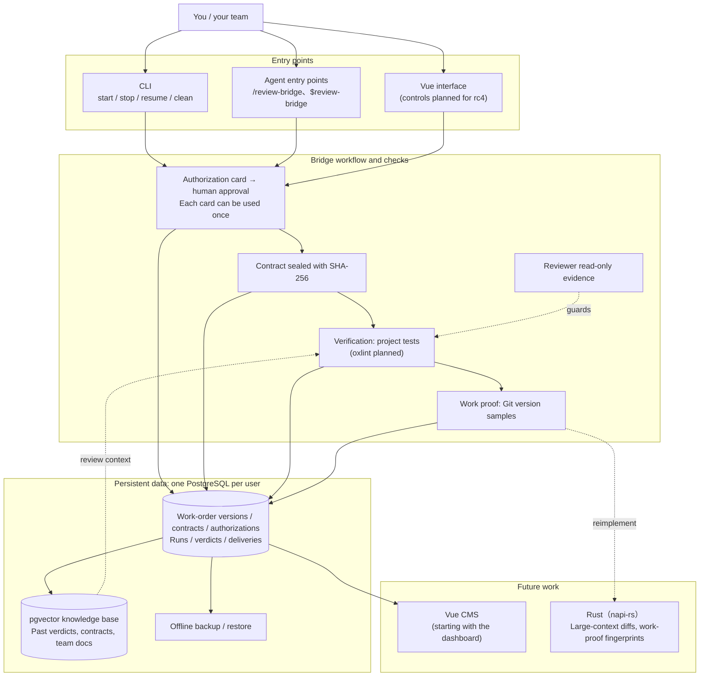

# Architecture and roadmap

Review Bridge is the command bridge for AI work: people set the direction, and Bridge manages authorization, execution, and acceptance. Its long-term goal is an **AI work audit system suitable for enterprise use**, where teams can trace who authorized work, which contract it followed, what changed, and who reviewed it.

This page describes the target architecture and development stages. rc3 focuses on the foundations of execution and auditing. Future components shown in the diagram are still planned.

## Target architecture

## Four core mechanisms

Bridge enforces these in code; skills, prompts, or model reports alone cannot provide them:

1. **Sealed contracts**: Bridge fills fields from marked work-order blocks, the writer extracts acceptance criteria, and the reviewer checks them. Bridge seals the contract with SHA-256. Implementation and review use the same contract; a change to its contents stops execution.
2. **Read-only reviewer checks**: CLI restrictions are checked and evidence kept. Codex tests whether its sandbox blocks a write; Claude Code checks the session mode and tool list. These provide different levels of evidence.
3. **Immutable authorization records**: work requires human approval, either directly at a terminal or relayed by an agent. Each card can authorize work once. Without valid authorization, work is refused.
4. **Work proof from Git**: evidence comes from Git state and version samples. The model's own claims are listed separately.

Other designs must have a precedent in the open-source ecosystem. Designs without one are not adopted. See [Design references](./references).

## Roadmap

| Stage | Scope | Status |
|---|---|---|
| **rc3** | The basic chain: install → `init` → work order → `start` → human approval → run → result file → **query records with SQL**, including a connection from VS Code. Agent, VS Code, and terminal entry points; four role pairings; read-only checks for both providers; personal connector isolation; OS-standard record locations. | In development; this documentation covers this version. |
| **Remaining rc3 work** | Run work orders in directory order, isolate parallel work with git worktrees, and verify the MCP servers available to reviewers individually. | Planned or in development; not yet available features. |
| **rc4** | Vue 3.5 interface to inspect contracts, runs, and per-criterion decisions; control work and set budgets; integrate storage and the interface. | Planned. |
| Future direction | pgvector knowledge base containing past verdicts, contracts, and team documentation for the reviewer. | No version assigned. |
| Later | A Vue CMS; Rust napi-rs modules for large-context diffs and work-proof fingerprints, retaining the JavaScript entry point on npm; oxlint in verification. | Initial direction. |

rc3 acceptance includes database access: a user must be able to connect from VS Code using the details printed by `init` and query work-order versions, contract hashes, verdicts, and the authorization source (`authorized_via`).

## Open decisions

The CMS feature scope, how and when RAG data reaches the reviewer, the first Rust implementation target, and enterprise deployment (multiple users, permissions, and services) remain open. The CMS stack is limited to Vue 3, TypeScript, Zod, oRPC, and Element Plus for now. Concrete plans will be documented once decided.
