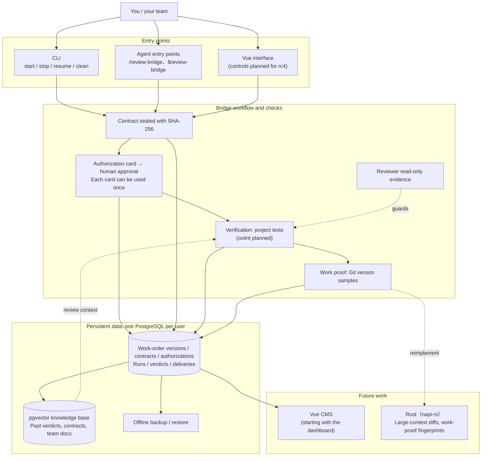

# Architecture and roadmap

Review Bridge is a command center for AI work. You set the direction; Bridge manages approval, execution, and acceptance. Its long-term goal is an **AI work audit system for teams and enterprises**, where you can trace who approved each job, which contract it followed, what actually changed, and who reviewed it.

This page describes the target architecture and development stages. Version 0.3.0-rc.3 provides the execution and audit foundations; later features shown in the diagram are still planned.

## Target architecture

## Four core mechanisms

Bridge enforces these in code; skills, prompts, or model reports alone cannot provide them:

1. **Sealed contracts:** code copies marked work-order blocks into the contract and splits the acceptance list into conditions without calling a model. Bridge seals it with SHA-256 and identifies it on the card. Implementation and review use the same contract; tampering stops execution.
2. **Verified reviewer restrictions:** CLI read-only settings are checked and the evidence is retained. Codex tests sandbox denial of a write; Claude Code checks the session mode and tool list. The evidence differs by provider.
3. **Immutable authorization records:** each run requires a person's approval, given directly in the terminal or relayed by an agent. Each card can authorize work only once. No valid authorization means no execution.
4. **Work proof from Git:** Git state and version samples provide evidence, with model claims listed separately.

Other designs must have a precedent in the open-source ecosystem. Designs without one are not adopted. See [Design references](./references).

## Roadmap

| Version | Scope | Status |
|---|---|---|
| **0.3.0-rc.3** | `npx review-bridge init` → work order → `start` → human approval → execution → result file → **SQL queries**, including VS Code database access. Agent, VS Code, and terminal entry points; four role pairings; both providers' read-only checks; personal connector isolation; contracts without model calls; directory pipelines; a project graph; and records in OS data directories | Released on npm November 10, 2026; the 0.3.1-rc.3 update was released November 12, 2026. This documentation covers 0.3.1-rc.3 |
| **Upcoming work** | Isolate concurrent work with git worktrees and verify each additional reviewer MCP server | Planned; not available yet |
| **rc4** | A Vue 3.5 interface for contracts, run status, acceptance decisions, work controls, and budgets, integrated with data storage | Planned |
| Future direction | Use pgvector to retrieve past decisions, contracts, and team documents for the reviewer | No version assigned |
| Later | Vue CMS; Rust modules through napi-rs for large-context diffs and work-proof fingerprints, retaining the npm JavaScript entry point; oxlint in verification | Direction only |

rc3 acceptance includes database access: a user must be able to connect from VS Code using the details printed by `init` and query work-order versions, contract hashes, verdicts, and the authorization source (`authorized_via`).

## Open decisions

The CMS feature scope, how and when RAG data reaches the reviewer, the first Rust implementation target, and enterprise deployment (multiple users, permissions, and services) remain open. The CMS stack is limited to Vue 3, TypeScript, Zod, oRPC, and Element Plus for now. Concrete plans will be documented once decided.
