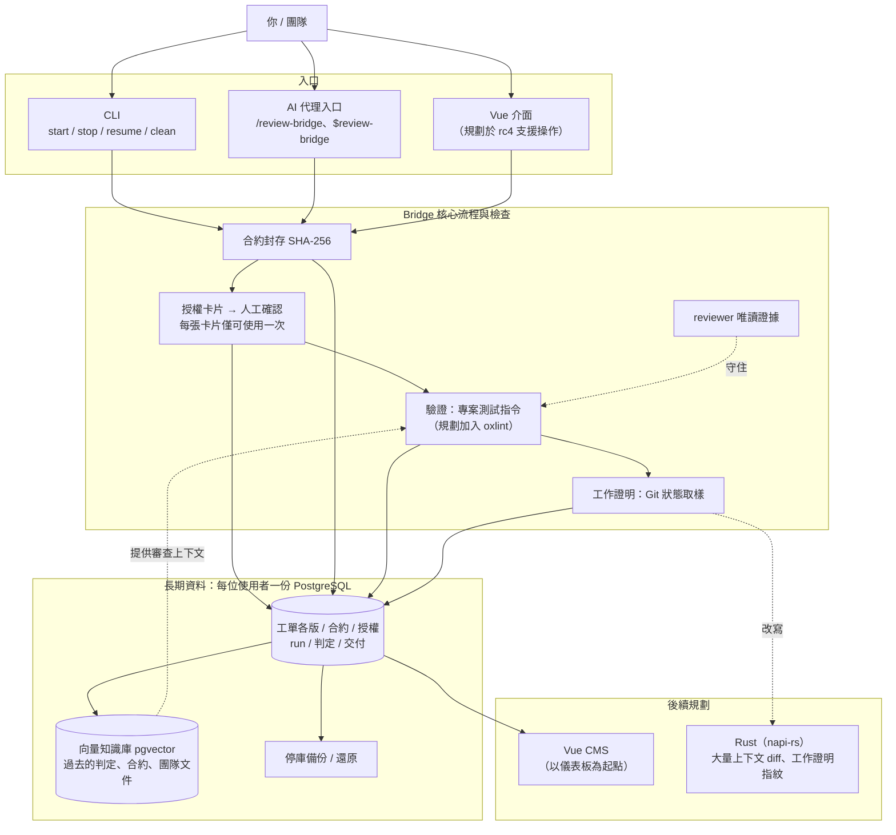

# 架構與里程碑

Review Bridge 是 AI 工作的司令部：由人決定方向，Bridge 管理授權、執行與驗收。長期目標是一套**可供企業使用的 AI 工作稽核系統**，讓團隊查明每次工作由誰授權、依據哪份合約執行、實際改了什麼，以及由誰審查。

本頁說明目標架構與開發階段。0.3.0-rc.3 著重於執行與稽核的基礎能力；圖中的後續功能仍在規劃中。

## 目標架構

## 四項核心機制

以下四項由 Bridge 的程式機制負責，不能僅靠 skill、提示詞或模型自行回報來確保：

1. **封存合約**：Bridge 用程式依工單標記把原文抄進合約欄位，並把驗收清單的每一項切成一條條件，不呼叫模型；以 SHA-256 封存並列在卡片上。後續實作與審查使用同一份合約，內容若遭修改便停止執行。
2. **檢查 reviewer 的唯讀限制**：使用 CLI 的唯讀設定並保留檢查證據。Codex 會測試寫入是否遭沙箱阻擋；Claude Code 則檢查工作階段的模式與工具清單，兩者的證據強度不同。
3. **保留不可變更的授權紀錄**：每次執行都須經人工確認，可在終端機直接授權，或由代理轉達。每張卡片只能授權一次，未取得有效授權便拒絕執行。
4. **從 Git 取得工作證明**：以 Git 狀態與版本取樣為依據，另行列出模型自行回報的內容。

其餘設計都必須找到開源生態中的既有做法作為依據；找不到參考依據的設計，不予採用。對照內容見[設計參考](./references)。

## 里程碑

| 版本 | 內容 | 狀態 |
|---|---|---|
| **0.3.0-rc.3** | 完成基礎流程：`npx review-bridge init` → 建立工單 → `start` → 人工授權 → 執行 → 結果檔 → **透過 SQL 查詢紀錄**，並可從 VS Code 連線。支援代理、VS Code 與終端機三種入口、四種角色配對、兩種 provider 的唯讀檢查、個人連接器隔離、零模型呼叫的合約、依檔名順序執行整個資料夾、專案的 graph，以及作業系統標準目錄中的執行紀錄 | 2026-11-10 發行到 npm；本站文件對應此版本 |
| **後續工作** | 以 git worktree 隔離並行工作，以及逐一驗證 reviewer 可使用的 MCP 伺服器 | 尚在開發規劃中，不能視為已可用功能 |
| **rc4** | Vue 3.5 介面：檢視合約、執行狀態與各項驗收判定，並操作工作、設定預算；同步整合資料儲存與介面 | 計畫中 |
| 後續方向 | pgvector：將歷次判定、合約與團隊文件納入向量知識庫，提供 reviewer 參考 | 尚未指定版本 |
| 之後 | Vue CMS 版本；以 Rust 的 napi-rs 原生模組處理大量上下文的差異比對與工作證明指紋，保留 npm 上的 JavaScript 入口；驗證流程加入 oxlint | 初步方向 |

rc3 的驗收包含資料庫查詢：使用者必須能依 `init` 顯示的連線資訊，從 VS Code 連上資料庫，查到工單版本、合約雜湊、判定與授權來源（`authorized_via`）。

## 尚待決定

尚待決定的項目包括 CMS 的功能範圍、向 reviewer 提供 RAG 資料的方式與時機、第一項以 Rust 實作的功能，以及企業部署形式（多人協作、權限與服務化）。CMS 目前僅確定採用 Vue 3、TypeScript、Zod、oRPC 與 Element Plus。具體方案確認後才會納入文件。
